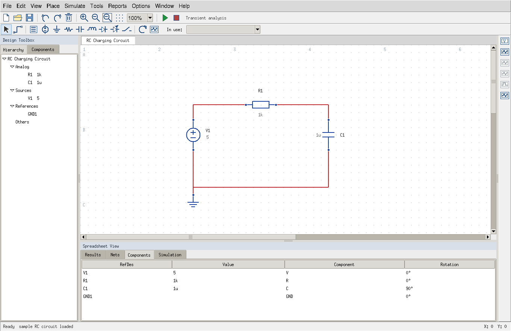

# Open Circuit Workbench

نسخة مكتبية مجانية مبنية على Qucs-S، تستهدف تدريجيًا سير عمل مألوفًا لمستخدمي NI Multisim. هذا المستودع ليس منتج NI ولا نسخة مكتملة من Multisim.

## Desktop prototype

For the independent, directly runnable Multisim-inspired interface, open `prototype/START_WINDOWS.bat` (Python with Tcl/Tk required), or run `python prototype/run_workbench.py`. See [prototype instructions](prototype/README.md). This GUI now invokes an independently installed ngspice engine for transient, DC and AC analyses. It includes source waveform controls, scope, meter, Bode, sampled spectrum and threshold traces. Qucs-S below remains a separate mature editor. See the [functional audit](docs/OPEN_SOURCE_AUDIT.md) for remaining gaps.



The component database additionally includes **1,229 Qucs-S-derived device models**, multi-terminal BJT/op-amp capture, DC sweeps, and Models/BOM/Diagnostics panels. See [source and interoperability notes](docs/INTEROPERABILITY_RESEARCH.md).

## Current milestone

The complete upstream Qt schematic editor is pinned as a Git submodule, not replaced by a mock web UI. Local additions provide reproducible builds and an independently checked RC simulation baseline. No proprietary code or artwork is included.

```sh
git clone --recurse-submodules https://github.com/ahpa5246-lgtm/Multisim.git
cd Multisim
# Debian/Ubuntu (administrator privileges required):
sudo apt-get install build-essential cmake qt6-base-dev qt6-tools-dev qt6-tools-dev-tools libqt6svg6-dev libqt6opengl6-dev flex bison gperf dos2unix ngspice
python3 scripts/build.py --jobs 2
./install/bin/qucs-s
```

Select ngspice as the simulation backend in Qucs-S. Windows remains a target; a tested Windows installer is not yet available. Do not treat the Linux build as Windows validation.

## Verify

```sh
python3 -m unittest discover -s tests -v
python3 scripts/verify_rc.py --output reports/rc.json
```

The second command requires real ngspice and fails if it is missing. It compares sampled capacitor voltage with the analytic exponential, including the voltage at one time constant. CI runs it separately from the GUI build. This proves a solver baseline, **not** equivalence with Multisim.

See [architecture](docs/DESIGN.md), [implementation plan](docs/PLAN.md), [parity matrix](docs/PARITY.md), and [review evidence](docs/REVIEW.md).

## Licensing

Our additions are GPL-2.0-or-later; see LICENSE. Qucs-S retains its original copyright notices and license in upstream/qucs-s/COPYING. Its nested projects retain their own licenses. No code from SimulIDE, Kirho, or the EW decoder has been merged. Preserve notices and provide corresponding source when distributing binaries.
