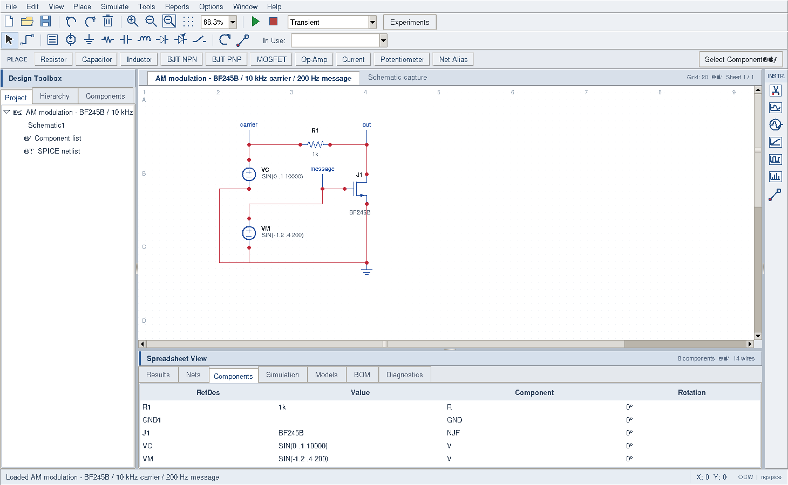
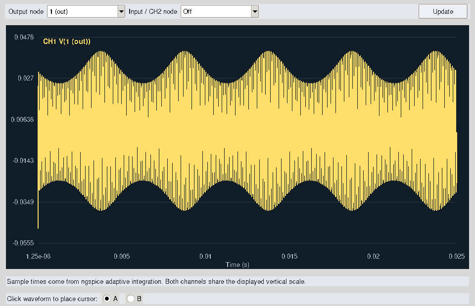
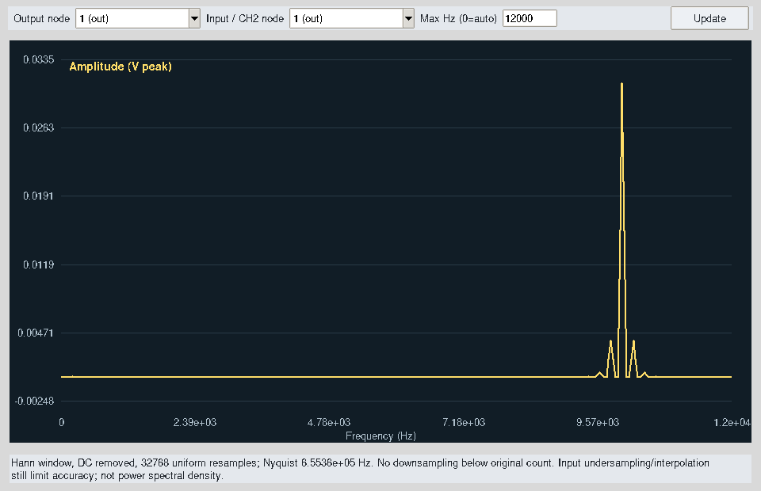

# University demonstration — 26 October 2026

This repository runs a **desktop application**, not a hosted website. Present it as
an independent open-source circuit workbench using ngspice and Qucs-S models.
Do not present it as NI Multisim or as complete feature parity.

## Launch and demonstrate AM

1. Install Python 3.10+ with Tcl/Tk and a complete ngspice installation. Run
   `python prototype/run_workbench.py`. If needed, use Options → Locate ngspice executable.
2. Choose **Simulate → Load AM Modulator**, then **F5**. This loads the hand-wired
   editable `examples/am-jfet.ocw.json`, configures 25 ms / 20000 requested time steps,
   and runs the actual solver. The experiment browser also provides the equivalent
   named-terminal topology under **Communications**.
3. In the scope select **out** as Output, and **Off** as CH2 to see the envelope.
   Select **carrier** as CH2 when comparing the two signals; the shared vertical
   scale and overlapping curves can obscure the smaller output.
4. Open **Simulate → Voltage Spectrum**, choose **out**, set maximum frequency to
   **12000**, and press Update. The main carrier is 10000 Hz; sidebands are 9800
   and 10200 Hz. This view uses a Hann window, so displayed FFT bins differ slightly
   from the independently measured tone amplitudes below.
5. Select VM before opening the function generator. It should show its actual
   -1.2 V offset, 0.4 V peak amplitude and 200 Hz frequency. Unchanged Apply keeps
   its source value. Changing a source invalidates results; rerun F5.
6. Export evidence with **Simulate → Export Simulation Data**. Save/reopen a circuit
   with File → Save As / Open. Document files contain the circuit; the quick AM
   menu also configures its analysis settings, which ordinary JSON files do not store.





## What the circuit does

VC supplies a 100 mV peak, 10 kHz sine through R1 = 1 kohm. The BF245B JFET
connects the output to ground. VM varies its gate voltage around -1.2 V by 0.4 V
at 200 Hz, changing its channel resistance and therefore the carrier amplitude.
This is a nonlinear resistive AM demonstrator with distortion, not an ideal
multiplier, a complete radio transmitter, or a validated hardware design.
No generated samples replace circuit simulation.

The transistor model comes from `JFETs.lib` in the already adapted Qucs-S model
catalog, pinned upstream at `46e47e8fabe852a9d6aab41d8a612ff5a78370c1`.
Source notices and GPL-2.0-or-later terms remain in
`prototype/workbench/data/THIRD_PARTY.md` and `COPYING.qucs-s`. The separately
installed ngspice executable performs all nonlinear simulation. No new solver,
waveform synthesis engine, NI assets or vendor firmware were written/copied.
The upstream Qucs-S submodule was actually fetched at its existing pin.

Measured on Linux / Python 3.12 / Tk 9 / ngspice 42:

| Measurement | Result |
|---|---:|
| Solver samples | 20027 |
| Carrier tone at 10000 Hz | 31.01085 mV peak |
| Lower sideband at 9800 Hz | 3.84542 mV peak |
| Upper sideband at 10200 Hz | 3.84541 mV peak |
| Equivalent depth, 2 × lower sideband / carrier | 24.8005% |

Tone measurements use time-weighted sine/cosine projection over the settled
5–25 ms interval (four complete message periods). The negative-control regression
sets VM to constant -1.2 V: the carrier remains and both sidebands must fall below
0.1 mV. AM has some DC/harmonic distortion; a symmetric sideband pair alone does
not establish low distortion, manufacturer accuracy or NI equivalence.
Full raw table and CSV are gzip-compressed under `evidence/university-demo/raw/`.
The exact deck, solver log and measurements JSON are alongside them.

## Verification and counting

```sh
python -m compileall -q prototype/workbench
xvfb-run -a python scripts/verify_presentation.py --output reports/presentation
xvfb-run -a -s '-screen 0 1600x1050x24' python prototype/scripts/capture_am_demo.py --output reports/am-demo
```

The audit requires a display and solver, fails on skips, and requires at least
200 passing **distinct leaf cases**. Parameterized subtests replace their parent
method in the count. It does not count reruns or individual assert statements as
extra tests. See the exact per-case ledger in
[evidence/university-demo/tests.json](evidence/university-demo/tests.json) and the
[full transcript](evidence/university-demo/verification.log). Most cases are the
existing 1226 adapted BJT operating-point smoke checks; these are not 1226 UI tools
or comprehensive transistor characterization. Course circuits, measurement math,
parsers, persistence, cancellation and real native widget interactions add coverage.

## Tool acceptance boundary

| Tool / workflow | Verified behavior | Important limit |
|---|---|---|
| Component browser, placement, wires, rotation, undo/redo | Native widget and document regressions | No PCB editor or package-pin verification |
| Zoom to Fit | Large circuit fits actual viewport | No new pan/viewport design |
| Function generator | Retains DC/sine/pulse settings; switching sources loads their values | Editing a pulse recalculates edges and uses zero delay; unchanged pulse preserved |
| Transient, DC operating point, AC, DC sweep | Real solver reference cases | Not every solver analysis is exposed |
| Scope | Two real channels, cursors, optional CH2 Off | Shared scale; no NI-style trigger/timebase controls |
| Multimeter/probe | Differential voltage, RMS, source current and source power | No ohmmeter; current limited to sources/inserted current probes |
| Bode | RC cutoff gain/phase regression and live panel | Voltage transfer, not RF S-parameters |
| Spectrum | Real AM trace; sampled FFT numerical regressions | Sampling/window limits; no calibrated PSD |
| Logic traces | Native thresholded-analog panel | Not a digital logic/HDL simulator |
| Experiments | 88 distinct circuit fixtures including AM | Generic/limited models and textbook approximations documented per fixture |
| Save/load/export, netlist, models/BOM/diagnostics | Existing roundtrip/export tests and native panels | Basic connectivity checks, not comprehensive ERC |
| Qucs-S mature editor | Pinned source fetched and preserved | Separate editor; not embedded; no new local Qt build in this revision |
| Windows, NI comparison, .ms14 roundtrip | **Untested / blocked** | No Windows machine, NI reference binary or genuine .ms14 fixture |
| MCU/HDL, advanced RF/noise/tolerance tools | **Missing in this UI** | Not made functional by listing external repositories |

The only new application logic is necessary repair of existing generator/fit
behavior, a scope visibility option, and access/configuration for the AM fixture.
Test/evidence scripts were added so the checks can be reproduced. Native Python
bytecode compilation and running Tk windows were verified; this does not mean a
new compiled Qucs-S binary or Windows installer was produced. Keep the earlier
full feature audit as historical; the table above supersedes it for this milestone.
