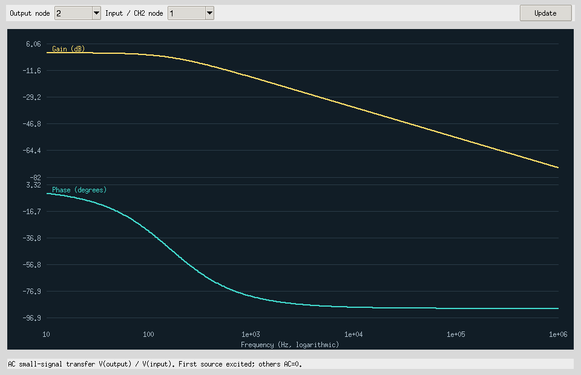
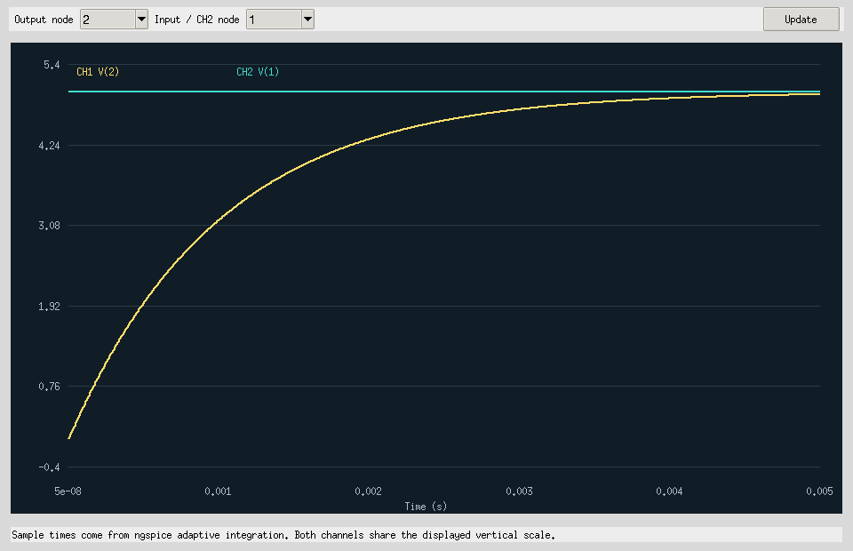

# Open Circuit Workbench — native desktop interface

## Classic CAD desktop workspace

The original Tk schematic editor now has a Multisim-style three-level component/command toolbar, an interactive **Project / Hierarchy / Components** navigator, a traditional schematic document tab, refined engineering symbols and wiring, and a reworked component picker. The real analysis and instrument functions are preserved. See the [classic UI implementation and visual verification](../docs/CLASSIC_UI.md); this is an original, independent interface and is **not** NI Multisim or a claim of exact parity.

Original Multisim-inspired Python/Tk interface with an independently installed **ngspice** engine. Existing Qucs-S is preserved separately; it is not embedded in this UI. No proprietary NI code, icons or firmware are included.

## Start

Requires Python 3.10+ with Tcl/Tk and an ngspice executable. Run `python run_workbench.py` from this folder, or double-click `START_WINDOWS.bat`. On Linux install `ngspice` with your package manager; Windows users can use an existing ngspice installation. Add its directory to PATH, set `OCW_NGSPICE` to the executable, or choose **Options → Locate ngspice executable** for this session. Solver absence raises a clear error; no silent educational-solver fallback.

## Working tools

- Place, wire, move, rotate, edit and delete R/C/L/V/GND, diode/LED and static-switch symbols. JSON save/load and undo/redo remain available.
- Run real ngspice transient or DC operating point; configure duration/steps/frequency range through Simulate → Analysis Settings.
- Two selectable scope channels use real adaptive sample times.
- Function Generator changes an actual voltage source to DC, sine, square or triangle. DC uses Offset; AC sweep excites the first voltage source with 1 V and sets other sources' AC amplitudes to zero.
- Differential voltage meter with time-weighted DC, total RMS, AC RMS, peak-to-peak and frequency-crossing readings. Also source-branch current and mean delivered power.
- Bode gain/phase from a real AC sweep, with selectable input/output node references.
- Voltage spectrum with uniform interpolation, Hann window, coherent-gain scaling and automatic radix-2 sample count preserving at least the captured record count. The display labels Nyquist and sampling limits.
- Thresholded analog logic trace viewer; **not a digital gate simulator**.
- Export generated netlist, solver log, raw table and CSV through Simulate → Export Simulation Data.
- Simulations run on a worker thread. Stop terminates ngspice; cancelled or edited-circuit results are discarded.

Each instrument displays a snapshot of its completed run; rerun after changing the circuit. Transient currently uses zero-state startup (`uic`). Diodes and LEDs use generic educational electrical models, even when an old file's label says 1N4148 or Red; there is no manufacturer validation or optical LED model. Open/closed switches use 1 TΩ / 1 mΩ static resistors. No dynamic switching while a run is active.

## Evidence and limits

Run `xvfb-run -a python -m unittest discover -s tests -v` on Linux with ngspice installed. Without DISPLAY/engine the corresponding tests explicitly skip; that is not a GUI/solver pass. Actual screenshots and RC/sine/AC raw evidence: [instrument evidence](../docs/evidence/ngspice-instruments/).

No full Multisim equivalence, advanced semiconductor library, arbitrary branch probe, complete logic/RF/HDL integration, .ms14 support or tested Windows installer is claimed. [The complete audit](../docs/OPEN_SOURCE_AUDIT.md) maps the missing tools to candidate projects and validation requirements. GPL-2.0-or-later applies to local code; external engines and upstream code retain their notices.

## Expanded component database

The component picker now exposes 1,229 pinned Qucs-S-derived model entries, grouped by NPN, PNP and OPAMP, alongside the basic parts. Search a device such as BC547B or LM358, then choose Place. Symbols use **electrical** C/B/E or +/−/VCC/VEE/OUT ordering, not package leg numbering. Models shows provenance; BOM lists quantities; Diagnostics flags isolated terminals and missing ground (a limited connectivity check).

Simulate includes DC Sweep / I–V and loadable op-amp/transistor examples. Choose a voltage source, range and step, then select a current or voltage output vector in the plot. The meter rejects sweep data because a voltage sweep axis is not time.

All 1,226 transistor models were smoke-checked with ngspice42 at one bias point; all three op-amps were checked in voltage followers. Comprehensive model/NI equivalence remains unverified. Full ngspice installation, including standard XSPICE code-model files, is required for polynomial op-amp macromodels.

Source, original license, contributor attribution and deterministic rebuild script are included under workbench/data and scripts/import_qucs_devices.py. The compressed catalog records 18 unsupported upstream entries explicitly. Read [interoperability research](../docs/INTEROPERABILITY_RESEARCH.md) for native Multisim-file work that remains pending.

## AM lecture Example 1 — live ngspice waveform

Open **Simulate → Load AM Example 1** and then **Simulate → Run Transient** (or F5). A real ngspice job opens the Oscilloscope on completion. The circuit is also an editable project at [examples/am-example1.ocw.json](../examples/am-example1.ocw.json).

The AM source syntax is `AM(carrier_Vpeak modulating_Vpeak carrier_Hz modulating_Hz)`, entered into a voltage source's Properties dialog or via **Function Generator → Waveform: AM**. The source is compiled to an ngspice behavioral voltage source and a zero-volt series current sense source. AM currently supports transient only; AC and DC sweeps reject it explicitly.

The course exercise gives 5.9 and 1.2 vertical divisions measured **peak-to-peak**, with 2 V per division. Therefore the envelope peaks on the positive Y axis are **5.9 V and 1.2 V**, carrier amplitude is **3.55 V**, modulating amplitude is **2.35 V**, and the modulation index is **66.197%**. This corrects the peak-to-peak-vs-peak interpretation in the lecture's solution while preserving its modulation index. Frequencies were not supplied, so the demo uses **20 Hz carrier** and **1 Hz modulation** to fit one full envelope period in the scope. Both the carrier and the modulating envelope start at their positive maxima (cosine start).

CI checks the analytically expected sample values at 0, 0.25, 0.5, 0.75 and 1.0 seconds using **real ngspice**; it also captures a real running circuit schematic and scope screen as Actions artifacts. See `prototype/tests/test_am.py` and `prototype/scripts/capture_am_example.py`.
